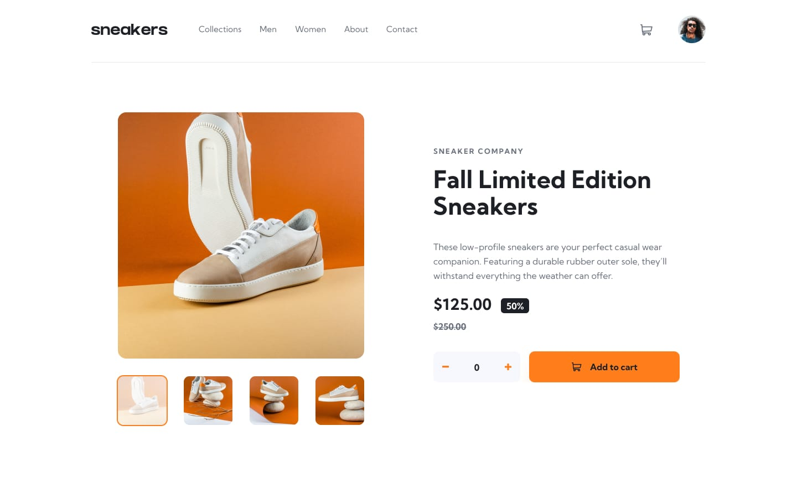
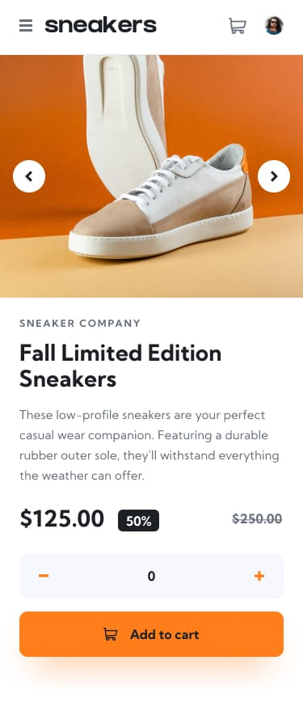

# Sneakers Product Page

A responsive e-commerce product page for a limited-edition sneaker. Browse product photos, choose a quantity, add the item to the cart, and review or remove it from the cart panel.

## Design previews

### Desktop



### Mobile



## Features

- Responsive layout for mobile and desktop
- Product image gallery with selectable thumbnails and mobile previous/next controls
- Gallery overlay with keyboard navigation using the arrow keys and Escape to close
- Quantity selector with a minimum of zero
- Add-to-cart button and cart panel with item quantity, total price, and remove action
- Responsive navigation menu with a selected-link indicator

## Tech stack

- React 19 and TypeScript
- Vite
- Tailwind CSS 4

## Getting started

Install [Node.js](https://nodejs.org/) and pnpm, then run:

```sh
pnpm install
pnpm dev
```

Open the local URL printed by Vite in your browser.

## Available commands

```sh
pnpm dev      # Start the development server
pnpm build    # Type-check and create a production build
pnpm preview  # Preview the production build locally
pnpm lint     # Run ESLint
```

## Project structure

```text
src/
  assets/       Product photos and interface icons
  components/   Header, product gallery, description, cart, and quantity controls
  App.tsx       Page state and component composition
  info.tsx      Product details and image data
```
